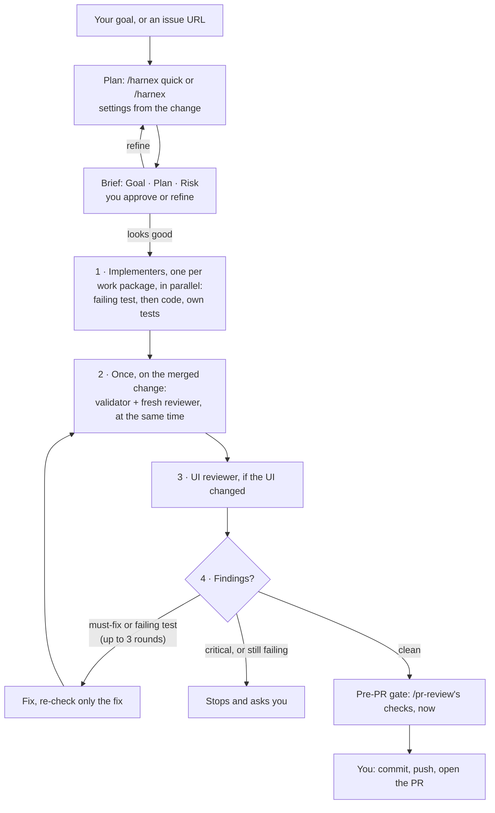

# harnex

**AI agents are fast at writing code and painful to ship.** harnex gives your
agent a workflow: a short plan you approve, test-first code, independent
validation and review, and a pre-PR gate, so review, QA and production find
nothing. Any language, any stack. Claude Code, Codex, OpenCode.

[Slides (3 min)](https://tankibaj.github.io/harnex/slides/harnex.html)

## The problem

| Pain | harnex |
|---|---|
| Works on my machine; review, QA or the deploy finds the rest | Runs the checks `/pr-review` uses before the PR exists (pre-PR gate) |
| I can't explain my own code | Smallest change that works, readable in one pass |
| The PR is too big to review | One purpose per PR; work over ~400 lines is split before coding |
| The plan is too big to read | A few lines in chat; ~40 lines (max 60) when risky |
| It codes for my laptop | Your repo's own test, build and run commands, not a guess |

## Install

| Agent | Command | Updates |
|---|---|---|
| Claude Code | `claude plugin marketplace add tankibaj/harnex && claude plugin install harnex@harnex` | itself |
| Codex | `codex plugin marketplace add tankibaj/harnex && codex plugin add harnex@harnex` | itself |
| OpenCode, others | `npx skills@latest add tankibaj/harnex -a opencode` | `npx skills update` |

**Sub-agents for Codex and OpenCode** (optional; Claude Code loads them from the plugin):
```bash
git clone https://github.com/tankibaj/harnex && node harnex/scripts/install-agents.mjs --all
```
> [!WARNING]
> **Skip this and Codex or OpenCode run every phase in one agent.** Same
> workflow, but the reviewer is no longer a fresh pair of eyes: it has seen
> the code being written. Install the sub-agents for an independent review.

**Browser for UI review and QA** (optional; without one these checks are reported `NOT VERIFIED`):
```bash
claude mcp add playwright -- npx @playwright/mcp@latest
codex mcp add playwright -- npx @playwright/mcp@latest
opencode mcp add          # then: playwright, local, npx @playwright/mcp@latest
```

## Use

```text
/harnex add a dark mode toggle to the settings page
/harnex https://github.com/you/app/issues/42
/harnex migrate sessions to the new token format
/harnex quick fix the typo in the signup error
/harnex explore cache the search results
```

| Command | When |
|---|---|
| `/harnex <goal or issue URL>` | Build something. It derives the settings from the change, shows Goal · Plan · Risk, and waits for your yes. |
| `/harnex quick <goal>` | Small and low-risk, or you want speed. |
| `/harnex explore <goal>` | Not sure which approach is best: builds 2–3 side by side, you keep one. |
| `/pr-review <PR URL>` | Review any PR (GitLab MRs too): criteria, a fresh review, questions on the risky lines. |
| `/qa <PR URL or goal>` | Manual test cases; on your yes, runs them in a real browser and against the OpenAPI. Standalone: run it on the PR `/harnex` opened. |
| `/apple-design`, `/web-design` | Build or review UI to Apple's Human Interface Guidelines: native apps (iOS, iPadOS, macOS) follow every rule; web apps get the rules that transfer. Your agent also loads them on its own for UI work. |
| `/retro` | Something slipped through. Proposes the check that would have caught it. `/retro html` saves a readable report. |

Input is mostly your goal in plain words. An issue URL (GitHub or GitLab)
adds its text. Another tracker (Jira, Linear…) works if its MCP is connected.

## How it works



| | `/harnex quick` | `/harnex` |
|---|---|---|
| **When** | One place, one repo, no risk area; picked on its own for small fixes | Everything else |
| **Plan** | harnex itself: change, root cause, proving test | Planner: a chat plan, or a plan doc (≤ 60 lines, fact-checked) with work packages |
| **You approve** | The [brief](skills/harnex/brief.md): Goal, Plan, Risk | The brief (+ the plan doc) |
| **Build** | harnex itself, test first | One implementer per work package, in parallel, each running its own tests |
| **Check** | harnex runs tests, lint, scans; fresh reviewer; UI reviewer if UI changed | Once, on the merged change: validator + reviewer at once, then the UI reviewer if UI changed |

Settings come from the change, one line in the brief: `Plan: doc · Tier: full · Reviewer: default · UI: yes`.
Plan doc for split, big (> 400 lines), multi-repo or unclear work; full test suite and the strongest
reviewer for auth, schema, security, CI, dependencies or a public API; UI review when screens change.

- **Any stack:** commands come from your repo (README, CLAUDE.md/AGENTS.md, CI, package scripts). Pin them in `.harnex/tiers.md` if you like ([tiers](skills/harnex/tiers/README.md)).
- **Any run target:** localhost, `docker compose up`, a local cluster; whatever the repo says.
- **Less code:** the reviewer flags unused code, silent failures, misleading names, config keys nothing defines.
- **Host:** GitHub first (`gh`), GitLab when the remote says so (`glab`).
- **Rules:** [standards](skills/harnex/standards.md). Your repo's CLAUDE.md, AGENTS.md and `.claude/rules/` win on conventions.
- **Metrics:** a hook logs names only (never code) to `~/.harnex/metrics.jsonl`; `/retro` reads them.

## Coming next
- Reads prod for you: logs, metrics and traces, before vs after a deploy.
- Smoke test after every deploy, without being asked.

## License
MIT
